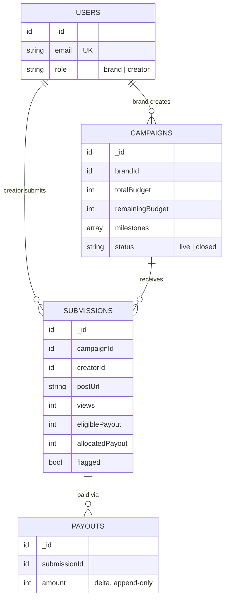

# Meme'd: Campaign Payout Tracker

A small creator marketplace. **Brands** create campaigns with a budget and a milestone ladder. **Creators** submit Instagram/YouTube posts and get paid when their views cross a milestone. Total payouts never exceed the campaign budget.

## How payouts work

Example ladder: `10K views → ₹500`, `50K → ₹2,000`, `100K → ₹5,000`.

- Creator is paid the **highest milestone crossed**, not the sum.
- Each update pays only the **difference** from what was already paid, so repeats never double-pay.
- If the budget runs out, the creator gets what is left (**partial payout**).
- If views drop, money is **never taken back**.
- Money is stored as **integer rupees**.

## Repository layout

```
.
├── backend/     Node.js + TypeScript + Express + MongoDB API
├── frontend/    Next.js + TypeScript app (login/signup, brand page, creator page)
├── code-flow/
│   ├── db.mmd       Database diagram (Mermaid)
│   └── design.mmd   Request/design flow diagram (Mermaid)
└── .gitignore
```

GitHub renders `.mmd` files as diagrams. Open them in `code-flow/` to see the schema and the flow.

## Tech stack

| Part | Tech |
|---|---|
| API | Node.js, TypeScript, Express, Zod validation |
| Database | MongoDB (Mongoose). **Must be a replica set** (transactions) |
| Auth | JWT, roles: `brand` and `creator` |
| Cache (optional) | Redis, live-campaign list only |
| Tests | Jest |
| Frontend | Next.js, TypeScript |
| Deploy | MongoDB Atlas, Render (API), Vercel (frontend) |

## Quick start

### Backend
```bash
cd backend
npm install
cp .env.example .env              # set MONGO_URI and JWT_SECRET
docker compose up mongo redis -d  # Mongo replica set + Redis
npm run seed                      # optional demo data
npm run dev                       # http://localhost:4000
```

Required env vars: `MONGO_URI`, `JWT_SECRET` (16+ chars). Optional: `PORT`, `REDIS_URL`, `CORS_ORIGIN`.

### Frontend
```bash
cd frontend
pnpm install
# set the API base URL (e.g. http://localhost:4000/api) in the env file
pnpm dev                          # http://localhost:3000
```

Demo accounts (after `npm run seed`), password `Password123!`:
`brand@example.com`, `arjun@example.com` (creator), `priya@example.com` (creator).

## Main API endpoints

Base URL: `/api`. Success: `{ "data": ... }`. Error: `{ "error": { "code", "message" } }`.

| Method | Path | Who | Purpose |
|---|---|---|---|
| POST | `/auth/signup`, `/auth/login` | anyone | Get a JWT |
| POST | `/campaigns` | brand | Create campaign |
| GET | `/campaigns/mine` | brand | Own campaigns, spent vs remaining |
| GET | `/campaigns` | logged in | Live campaigns |
| POST | `/submissions` | creator | Submit a post link |
| GET | `/submissions/mine` | creator | Own submissions |
| PATCH | `/submissions/:id/views` | **no auth** | Update views, trigger payout (simulates platform data) |
| GET | `/earnings/me` | creator | Total earnings |

Full request/response examples are in [`backend/README.md`](backend/README.md).

## Data model



## How the backend is organised

```
route → authenticate → authorize → validate → controller → service → repository → model
```

- **controllers**: HTTP only
- **services**: business rules and transactions
- **repositories**: the only layer that touches Mongoose
- **domain**: pure functions (payout calculation, budget cap, spike detection), no I/O

## Safety against overspending

- Budget is deducted with a **single atomic MongoDB update** (no read-then-write).
- Budget, submission and payout-ledger writes happen in **one transaction**. All succeed or all roll back.
- The submission update is guarded on the `allocatedPayout` value that was read, so racing requests cannot pay the same amount twice.
- Concurrency tests: 10 simultaneous ₹5,000 payouts against a ₹3,000 budget spend exactly ₹3,000.

## Bonus features

- **Spike flag:** a submission is flagged when views gain ≥ 5,000 **and** the rate is above 20,000 views/hour. Flagging does not block payment.
- **Redis cache:** live-campaign list cached for 30 s. The app works fine without Redis.

## Testing

```bash
cd backend
npm test              # unit + HTTP tests, no database needed
npm run test:db       # concurrency tests (in-memory replica set)
npm run test:coverage # domain layer held at 100%
```

## What if it grows to 10,000 users?

**Short answer:** the current design handles 10,000 users comfortably. The real risk is not user count, it is **many people hitting the same campaign at once**.

### Rough load
10,000 creators updating views about once an hour is only ~3 writes per second. A single MongoDB replica set handles that easily. Traffic spikes (a viral campaign) are what matter.

### What could break, and the fix

| Problem | Why it happens | Fix |
|---|---|---|
| **Hot campaign document** | Every payout updates the same `remainingBudget` field, so writes to one campaign queue up and transactions can conflict | Retry with backoff (already guarded). Next step: put view updates on a **queue** (BullMQ/Redis) and process per campaign in order |
| **Platform view updates arrive in bursts** | Real platforms push or get polled in batches | Queue + worker processes, rate-limit per submission, skip updates where views did not change |
| **Slow list endpoints** | `GET /campaigns` grows with campaigns | Pagination, Redis cache (already built), index on `status` |
| **Single API instance** | Render free tier sleeps and has 1 instance | Auth is stateless JWT, so run **multiple API instances behind a load balancer** |
| **Database size and load** | `payouts` and `submissions` grow forever | Paid Atlas tier, indexes on `creatorId`, `campaignId`, `submissionId`, read earnings from a secondary, archive old ledger rows |
| **Abuse / fake views** | More users, more cheating | Spike flag (built), plus a review queue for flagged submissions and holding payouts until reviewed |
| **Visibility** | Hard to debug at scale | Structured logs (built), add metrics and alerts: payout latency, transaction retries, 409 rate |

### Step-by-step growth plan

1. **Now (up to ~10K users):** one Atlas cluster, 2+ API instances, Redis cache on.
2. **Busy campaigns:** move `PATCH /views` processing to a queue with workers.
3. **Very hot campaigns:** split the budget into chunks (for example 10 sub-budgets). Each payout draws from one chunk, which spreads writes across documents. Rebalance when a chunk runs dry.
4. **Much larger:** shard `submissions` and `payouts` by `campaignId` and use separate read replicas for dashboards.

### Things that stay the same at any scale
Integer money, delta-based payouts, atomic budget deduction, and the append-only ledger. These are what keep the numbers correct, so any scaling change must preserve them.

## Deployment

- **Database:** MongoDB Atlas free tier (replica set included).
- **API:** Render. Build `npm install && npm run build`, start `npm start`. Free tier sleeps when idle, so the first request is slow.
- **Frontend:** Vercel, with the API URL set to your Render URL.
- **Docker:** `docker compose up --build` runs API + Mongo replica set + Redis.
